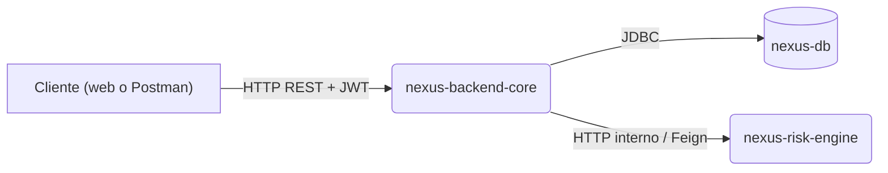

# **Nexus Finance - Enterprise Microcredit Platform 🚀**

[](https://github.com/nexus-fintech/nexus-finance-platform/actions/workflows/ci.yml)

**Plataforma distribuida para la gestión de microcréditos: un core bancario en Java y un motor de riesgo con IA en Python, orquestados con Docker Compose.**

## **📋 Visión General del Sistema**

**Nexus Finance** resuelve la complejidad de otorgar créditos mediante una arquitectura desacoplada. El sistema permite registrar clientes, solicitar préstamos y, mediante una **Capa Anticorrupción (ACL)**, consultar un motor externo de riesgo para aprobar o rechazar solicitudes en tiempo real, generando automáticamente cronogramas de pago con precisión financiera.

### **🏗️ Arquitectura de Contenedores**



1. **nexus-backend-core (Spring Boot 3.4):** clientes y préstamos (DDD/CQRS), amortización con el sistema francés, seguridad con JWT y la orquestación de la aprobación.
2. **nexus-risk-engine (Python FastAPI):** microservicio sin estado. Un Random Forest estima la probabilidad de aprobación y reglas de negocio fijan el puntaje, la tasa y el monto máximo.
3. **nexus-db (MySQL 8.0):** persistencia del core transaccional.

| Repositorio | Qué contiene |
| :--- | :--- |
| [nexus-backend-core](https://github.com/nexus-fintech/nexus-backend-core) | Core bancario en Java |
| [nexus-risk-engine](https://github.com/nexus-fintech/nexus-risk-engine) | Motor de riesgo en Python |
| [nexus-frontend-web](https://github.com/nexus-fintech/nexus-frontend-web) | Aplicación web en Angular |
| nexus-finance-platform (este) | Orquestación, configuración y la prueba de punta a punta |

## **🚀 Guía de Inicio Rápido**

### **Prerrequisitos**

- Docker con Compose.
- Git, y Python 3 para la prueba de punta a punta.

### **Pasos**

```bash
git clone https://github.com/nexus-fintech/nexus-finance-platform.git
cd nexus-finance-platform
# Los servicios se clonan aquí dentro; el .gitignore los excluye
git clone https://github.com/nexus-fintech/nexus-backend-core.git
git clone https://github.com/nexus-fintech/nexus-risk-engine.git

cp .env.example .env      # completa las contraseñas, la clave JWT y el administrador
docker compose up --build --wait
```

La primera vez tarda unos minutos descargando las dependencias de Maven y pip. `--wait` termina cuando los tres servicios responden a su chequeo de salud.

## **🔌 Puntos de Acceso**

| Servicio | URL local | Descripción |
| :--- | :--- | :--- |
| **Backend API Docs** | <http://localhost:8080/swagger-ui.html> | Swagger UI para probar los endpoints de clientes y préstamos |
| **Risk Engine Docs** | <http://localhost:8000/docs> | Swagger UI del motor de IA (Python) |
| **Base de Datos** | `localhost:3307` | Usuario `nexus` con la contraseña `MYSQL_PASSWORD` de `.env` |

Los puertos se publican solo en `127.0.0.1`. Si ya están ocupados, `BACKEND_PORT`, `RISK_ENGINE_PORT` y `DB_PORT` en `.env` los cambian.

## **🔐 Quién Puede Hacer Qué**

El registro público (`POST /api/v1/authentication/sign-up`) crea siempre clientes. El administrador, que aprueba préstamos y gestiona clientes, se crea al arrancar con `NEXUS_ADMIN_USERNAME` y `NEXUS_ADMIN_PASSWORD`. Cada cliente ve y modifica solo su perfil y sus préstamos. El detalle está en el README de [nexus-backend-core](https://github.com/nexus-fintech/nexus-backend-core).

## **🧪 Prueba de Punta a Punta**

`scripts/smoke_test.py` recorre la plataforma levantada como lo harían un cliente y un analista:

1. Un cliente se registra pidiendo ser administrador: queda como cliente. Un cuerpo inválido responde `400`.
2. Crea su perfil y pide un préstamo, que queda `REQUESTED`.
3. Intenta aprobarlo él mismo: `403`.
4. El administrador lo aprueba: el backend consulta al motor de riesgo, el préstamo queda `ACTIVE` y el cliente ve su cronograma de 6 cuotas.

```bash
export NEXUS_ADMIN_USERNAME=... NEXUS_ADMIN_PASSWORD=...   # los mismos de .env
python scripts/smoke_test.py http://localhost:8080
```

La CI (GitHub Actions) levanta la plataforma con la rama `main` de cada servicio y corre esta prueba en cada push y cada lunes: los servicios cambian en sus propios repositorios y así se comprueba que sigan encajando.

## **🛠️ Configuración (.env)**

| Variable | Para qué |
| :--- | :--- |
| `MYSQL_ROOT_PASSWORD` | Contraseña de root de MySQL, solo para administrar |
| `MYSQL_PASSWORD` | Contraseña del usuario `nexus`, con el que entra el backend |
| `JWT_SECRET` | Firma los tokens de sesión: 32 caracteres aleatorios o más (`openssl rand -hex 32`) |
| `NEXUS_ADMIN_USERNAME`, `NEXUS_ADMIN_PASSWORD` | Primer administrador |
| `CORS_ALLOWED_ORIGINS` | Origen del frontend; por defecto `http://localhost:4200` |
| `BACKEND_PORT`, `RISK_ENGINE_PORT`, `DB_PORT` | Puertos en tu PC, si 8080, 8000 o 3307 están ocupados |

Dentro de la red de Compose, el backend llega a la base y al motor por sus nombres de servicio (`nexus-db`, `nexus-risk-engine`).

## **👤 Autor**

**Angel Antonio Cancho Corilla** - _Ingeniero de Software Full Stack_
